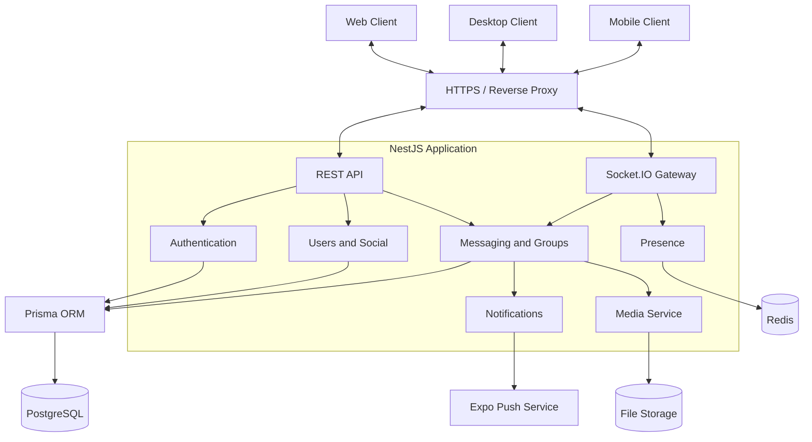

<div align="center">


# MikosChat Server

**The infrastructure behind independent communication.**

An open-source, self-hosted real-time messaging backend.

[](LICENSE)
[](https://nestjs.com)
[](https://docker.com)
[](#project-status)

[](https://github.com/Matisiowy/MikosChat-Server/actions)
[](https://github.com/Matisiowy/MikosChat-Server/stargazers)
[](https://github.com/Matisiowy/MikosChat-Server/issues)

[Website](https://chat.mikrusmusic.pl) |
[Web Client](https://github.com/Matisiowy/MikosChat-Web) |
[Desktop Client](https://github.com/Matisiowy/MikosChat-Desktop) |
[Documentation](docs/)

</div>

---

## Overview

MikosChat Server is the core of the MikosChat ecosystem.

It provides authentication, messaging, social features, persistent data storage, real-time events and media management through a modular TypeScript backend.

The project is designed for self-hosting, transparent development and independent infrastructure.

## Core capabilities

| Module | Capabilities |
| :--- | :--- |
| Authentication | Registration, login, JWT access tokens, refresh rotation |
| Sessions | Revocation, browser cookies and client session management |
| Users | Profiles, avatars and user discovery |
| Social | Friend requests and user blocking |
| Conversations | Direct messaging and group conversations |
| Groups | Membership, permissions and administration |
| Messages | Send, edit, delete, reply and search |
| Reactions | Emoji reactions |
| Receipts | Delivery and read tracking |
| Presence | Online status and typing events |
| Media | Attachments and authenticated downloads |
| Notifications | Mobile push notification integration |
| Realtime | Socket.IO event distribution |

## Technology stack

<div align="center">


</div>

## System architecture



## Self-hosting

### Requirements

- Docker Engine
- Docker Compose v2
- Persistent storage
- HTTPS reverse proxy for public deployments

### Docker Compose

```bash
git clone https://github.com/Matisiowy/MikosChat-Server.git
cd MikosChat-Server

cp .env.docker.example .env
```

Review the environment configuration before starting the stack.

Replace example credentials and generate a strong JWT signing secret. Never expose PostgreSQL or Redis directly to the public internet.

```bash
docker compose up -d --build
docker compose ps
docker compose logs -f
```

Use the included `compose.web.yaml` as the starting point for an integrated web deployment.

Docker Compose files and environment examples are the authoritative source for deployment configuration.

> [!IMPORTANT]
> Back up PostgreSQL data, uploaded media and configuration before performing upgrades.

## Native development

### Requirements

- Node.js 24
- PostgreSQL 15
- Redis 7
- npm

```bash
git clone https://github.com/Matisiowy/MikosChat-Server.git
cd MikosChat-Server

npm ci
cp .env.example .env
```

Configure your development database, Redis connection and JWT secret.

```bash
npx prisma generate
npx prisma migrate deploy
npm run build
npm run start:dev
```

## Configuration

| Variable | Purpose |
| :--- | :--- |
| `NODE_ENV` | Application environment |
| `PORT` | HTTP listen port |
| `DATABASE_URL` | PostgreSQL connection |
| `REDIS_URL` | Redis connection |
| `JWT_SECRET` | Access token signing secret |
| `APP_NAME` | Application name |
| `APP_URL` | Public application URL |
| `API_URL` | Public API URL |
| `STORAGE_PATH` | Uploaded media storage |
| `CORS_ORIGINS` | Allowed client origins |
| `WEB_AUTH_ORIGINS` | Trusted browser authentication origins |
| `TRUST_PROXY` | Explicitly trusted reverse proxies |

Consult the environment examples and source code for defaults and additional variables.

## API

The REST API uses the versioned prefix:

```text
/api/v1
```

### Endpoint examples

| Method | Endpoint | Description |
| :--- | :--- | :--- |
| GET | `/api/v1/health` | Service health |
| GET | `/api/v1/version` | Application version |
| POST | `/api/v1/auth/register` | Create an account |
| POST | `/api/v1/auth/login` | Authenticate a native client |
| POST | `/api/v1/auth/refresh` | Rotate refresh credentials |
| POST | `/api/v1/auth/web/login` | Browser authentication |
| POST | `/api/v1/auth/web/refresh` | Refresh browser session |
| GET | `/api/v1/auth/me` | Current authenticated user |
| GET | `/api/v1/conversations` | User conversations |
| GET | `/api/v1/conversations/:id/messages` | Message history |
| POST | `/api/v1/conversations/:id/messages` | Send a message |
| GET | `/api/v1/conversations/:id/messages/search` | Search messages |

Swagger documentation is available at `/docs` in development mode.

## Real-time protocol

MikosChat uses Socket.IO with authenticated connections.

```text
Transport path: /socket.io
Namespace:      /chat
```

Examples of server events:

| Event | Description |
| :--- | :--- |
| `session:ready` | Authenticated connection initialized |
| `message:new` | New message |
| `message:updated` | Message edited |
| `message:deleted` | Message deleted |
| `receipt:update` | Delivery or read receipt |
| `reaction:update` | Reaction changed |
| `typing:update` | Typing state changed |
| `presence:update` | User presence changed |
| `conversation:updated` | Conversation changed |
| `conversation:removed` | Conversation access removed |

Clients should handle reconnection and synchronize state through the REST API when necessary.

## Database architecture

PostgreSQL stores persistent application data through Prisma ORM.

Core entities include:

- Users and sessions
- Friendships and blocks
- Conversations and members
- Messages and attachments
- Reactions and receipts
- Registered notification devices

Redis is used for transient real-time state and presence management.

## Project structure

```text
MikosChat-Server/
├── .github/             CI/CD and repository automation
├── docs/                Project documentation
├── prisma/              Database schema and migrations
├── scripts/             Integration test utilities
├── src/
│   ├── auth/            Authentication and sessions
│   ├── users/           User management
│   ├── friends/         Friendships
│   ├── conversations/  Conversations
│   ├── messages/       Messaging and search
│   ├── realtime/       Socket.IO gateway
│   ├── presence/       Online presence
│   ├── groups/         Group administration
│   └── notifications/  Push notifications
├── test/               Test suites
├── Dockerfile
├── compose.yaml
└── compose.web.yaml
```

## Security

MikosChat implements several application security controls:

- Argon2id password hashing
- Short-lived JWT access tokens
- Refresh token rotation
- Hashed refresh credentials
- Session revocation
- Conversation membership authorization
- Request validation and rate limiting
- Authenticated attachment downloads
- HttpOnly browser refresh cookies
- Trusted browser origin validation
- Restricted CORS configuration

> [!WARNING]
> MikosChat does not currently provide end-to-end message encryption.
> Server operators may have access to stored messages and associated data.

See [SECURITY.md](SECURITY.md) for responsible vulnerability reporting.

## Quality and automation

The repository includes GitHub Actions workflows for backend validation, Docker integration testing and container publishing.

Integration tests cover messaging search, authorization boundaries and browser authentication.

View the [Actions dashboard](https://github.com/Matisiowy/MikosChat-Server/actions) for current build information.

## Roadmap

- [x] Modular backend architecture
- [x] User authentication and persistent sessions
- [x] Direct and group messaging
- [x] Social features
- [x] Real-time presence and typing
- [x] Message receipts and reactions
- [x] Media attachments
- [x] Conversation search
- [x] Browser session authentication
- [x] Mobile push notification integration
- [x] Docker deployment configuration
- [x] CI integration tests
- [ ] WebRTC voice infrastructure
- [ ] Video calls
- [ ] Screen sharing
- [ ] End-to-end encryption
- [ ] Distributed deployment validation

## Ecosystem

| Repository | Description |
| :--- | :--- |
| [MikosChat Server](https://github.com/Matisiowy/MikosChat-Server) | Core messaging infrastructure |
| [MikosChat Web](https://github.com/Matisiowy/MikosChat-Web) | Official web client |
| [MikosChat Desktop](https://github.com/Matisiowy/MikosChat-Desktop) | Native desktop client |

## Contributing

Contributions are welcome.

Read [CONTRIBUTING.md](CONTRIBUTING.md) for development guidelines and pull request recommendations.

## Project status

> [!NOTE]
> MikosChat is an alpha-stage project under active development. Production deployments should be evaluated against their own security, availability and data protection requirements.

## License

Licensed under the [GNU Affero General Public License v3.0](LICENSE).

---

<div align="center">

**MikosChat**

Open communication. Independent infrastructure.

Developed by [Matisiowy](https://github.com/Matisiowy)

Copyright © 2026 MikosChat contributors.

</div>
